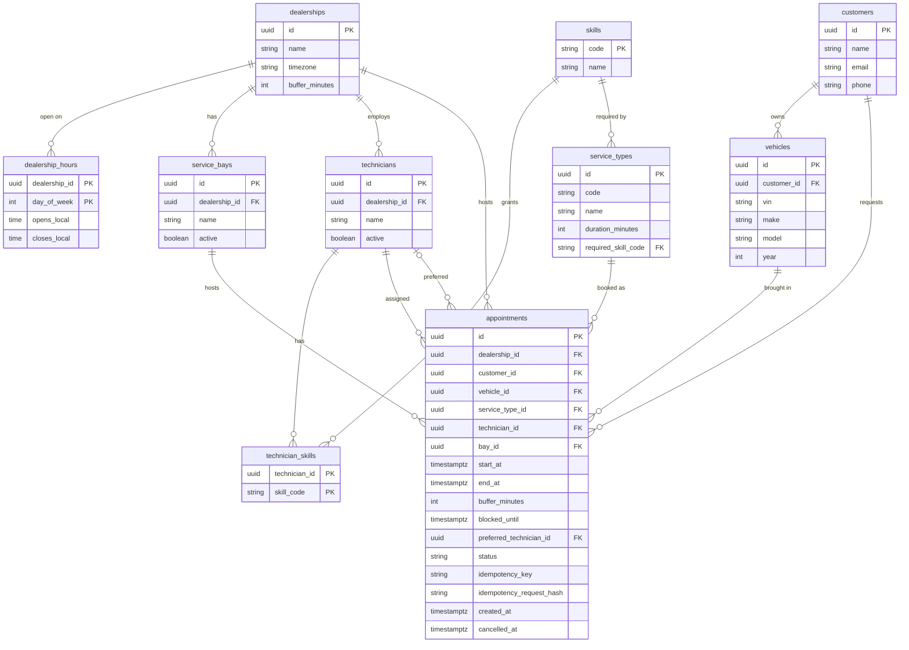
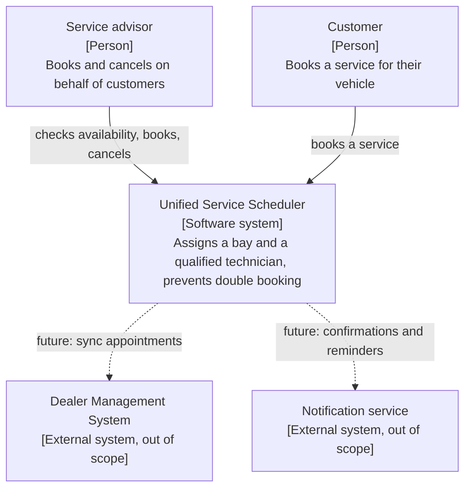
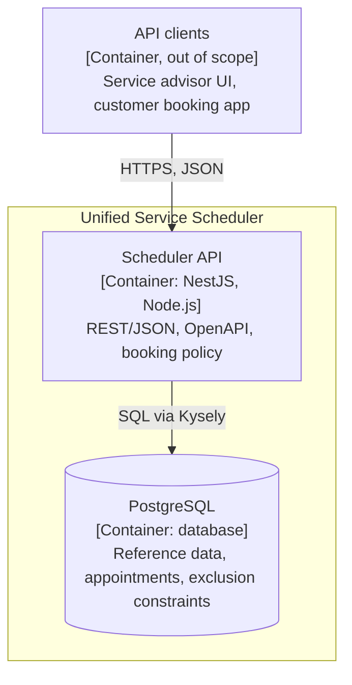
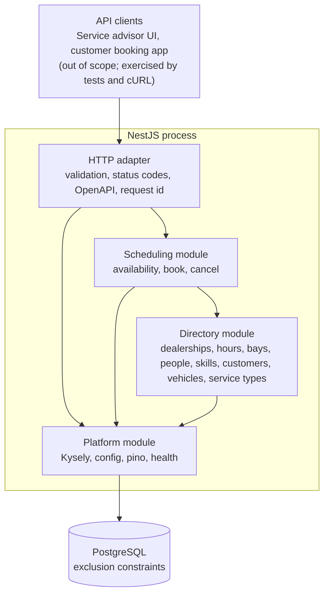
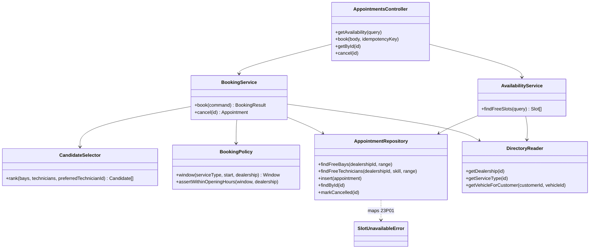
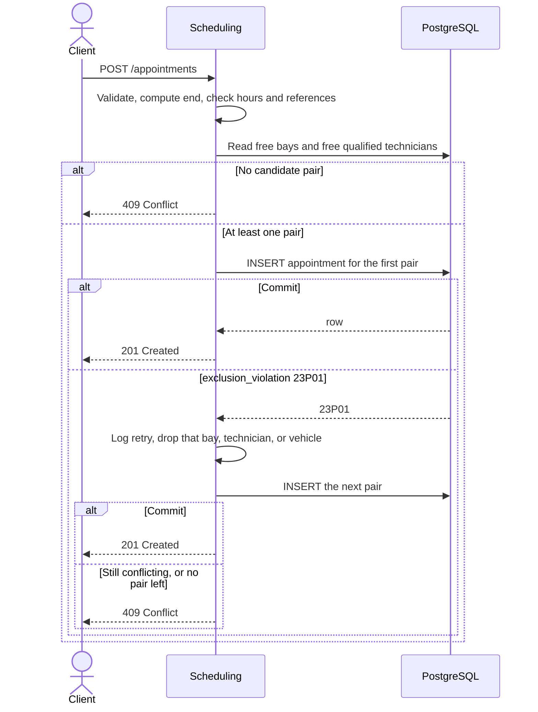

# Unified Service Scheduler — System Design

Scenario A (Ownership): a customer books a vehicle in for a service at a dealership and a desired time. The backend confirms a **service bay** and a **qualified technician** for the **whole duration**, then stores the appointment.

This document describes the design the code in this repository implements: the data model, the booking flow, the API contract, and how double booking is prevented. It lives with the source, so a change to the design and the code that follows it land in the same commit. The frontend is out of scope; clients are mocked from the API contract below.

The booking rule, in one sentence: compute the window from the service type, reject it if the work falls outside that dealership's opening hours, choose a free bay and a technician who has the required skill, hold the bay, the technician, and the vehicle for the work plus a 15-minute turnaround, and let a Postgres exclusion constraint be the thing that actually prevents a double booking.

## Requirements

The requirements below come from the Scenario A brief and the decisions in [Assumptions](#assumptions). Each one names the mechanism or section that satisfies it, and [Traceability](#traceability) maps them to tests.

### Functional requirements

| Id | Requirement | Satisfied by |
| --- | --- | --- |
| FR-1 | A client can query free start times for a dealership, service type, and date range. The answer is a read, not a hold. | `GET /availability` in [API contract](#api-contract); working assumption 6 |
| FR-2 | A client can book a vehicle for a service type at a start time. The system assigns a free bay and an active, qualified technician of that dealership for the whole duration (`end_at = start_at + duration_minutes`). | `POST /appointments`; [Booking data flow](#booking-data-flow) |
| FR-3 | A bay, a technician, or a vehicle is never in two confirmed appointments whose blocked ranges overlap. | Exclusion constraints on `[start_at, blocked_until)`; [Concurrency](#concurrency) |
| FR-4 | Each booking holds its resources for the work plus the dealership's turnaround buffer (15 minutes for Northbridge), frozen on the row as `buffer_minutes` and `blocked_until`. | [Turnaround buffer](#turnaround-buffer) |
| FR-5 | The work must fit inside a single opening period of the dealership, in its IANA timezone. The buffer may run past close. Otherwise the request is 422. | Working assumption 2; Scheduling module |
| FR-6 | A preferred technician is a soft preference: assigned first when free and qualified, otherwise another qualified technician is used. The response reports `preferenceHonored` (`true`, `false`, `null`). An unknown technician id is 404. | Decision 2; pair ordering in [Booking data flow](#booking-data-flow) |
| FR-7 | When no bay and qualified technician pair is free, the booking fails with 409 and writes nothing. | Insert-retry policy, at most three attempts; [Retry and idempotency policy](#retry-and-idempotency-policy) |
| FR-8 | A client can cancel an appointment. Cancelling frees the bay, technician, and vehicle immediately, buffer included. Repeating the cancel returns the same row. | `PATCH /appointments/:id/cancel`; constraints ignore cancelled rows |
| FR-9 | A client can fetch an appointment by id. | `GET /appointments/:id` |
| FR-10 | The vehicle must belong to the given customer, and `start_at` must be an ISO-8601 instant with an offset, not more than a minute in the past. | Validation in the HTTP adapter and Scheduling module; working assumptions 7 and 10 |

### Non-functional requirements

| Id | Requirement | Satisfied by |
| --- | --- | --- |
| NFR-1 | **Correctness under concurrency, the top priority.** No double booking under any interleaving of requests, process replicas, or future code paths. | Postgres exclusion constraints as the lock; optimistic insert, retry on `23P01` (Postgres SQLSTATE `exclusion_violation`, raised when a row overlaps an existing one under an exclusion constraint); [Concurrency](#concurrency) |
| NFR-2 | **Idempotency.** A client that retries `POST /appointments` with the same `Idempotency-Key` and body gets the original appointment, not a second one. | [Retry and idempotency policy](#retry-and-idempotency-policy); vehicle constraint as a backstop |
| NFR-3 | **Latency.** Booking and availability respond fast enough for an advisor at the desk. | Small candidate set, indexed overlap queries, no cross-service calls; targets in [Service level objectives](#service-level-objectives) |
| NFR-4 | **Availability.** The API is up during dealership opening hours. | Stateless process, safe to run as replicas; [Scalability and reliability](#scalability-and-reliability) |
| NFR-5 | **Observability.** Every booking outcome can be traced to a request. | pino JSON logs, request id, `booked`/`retry`/`conflict` outcomes, `GET /health`; [Observability](#observability) |
| NFR-6 | **Operability.** One command runs the system locally; configuration is two variables. | docker compose, migrations at startup, seed as a separate one-shot step; [Runtime shape](#runtime-shape) |
| NFR-7 | **Maintainability and testability.** Booking policy lives in one module; the invariant is proven by tests against a real database. | Modular monolith in [Architecture (C4)](#architecture-c4); [Testing strategy](#testing-strategy) |
| NFR-8 | **Security.** Authentication, authorization, and rate limiting are out of scope for v1. Logs carry ids, not personal data. | Working assumption 8; [Out of scope](#out-of-scope) |

### Service level objectives

An SLA is a contractual commitment to a customer, with consequences when it is missed. The figures below are target SLOs for this service. They are assumed, not measured: there is no load test or production traffic behind them yet.

| SLO | Target (assumed) | Scope |
| --- | --- | --- |
| `POST /appointments` latency | p95 < 300 ms | Single-dealership load, including retries |
| `GET /availability` latency | p95 < 200 ms | Single-dealership load, one day of slots |
| Availability | 99.9% of requests succeed (non-5xx) | During dealership opening hours |
| Double bookings | 0 | Hard invariant, not an error budget; enforced by the database |

## Assumptions

### Decided by the candidate

1. **Buffer: 15 minutes, configurable per dealership.** A booking holds the bay, the technician, and the vehicle for the service duration plus a turnover tail. Northbridge is seeded with 15 (`dealerships.buffer_minutes`). The number is copied onto the appointment and enforced by the exclusion constraints on `[start_at, blocked_until)`, so a job that ends at 10:00 keeps the resource until 10:15. A later job may start at 10:15 and not at 10:14. The mechanism is in [Turnaround buffer](#turnaround-buffer).
2. **Preferred technician: soft preference.** If the named technician is free and qualified, they are assigned first. If they are busy, inactive, missing the skill, or employed at another dealership, the booking falls back to any other qualified technician. The response reports `preferenceHonored`: `true`, `false`, or `null` when the request named nobody. An id that matches no technician is 404. A favourite who cannot do the job does not, by itself, fail the booking.
3. **Working hours: dealership opening hours only.** Technician shifts are not in this design. An active technician is available whenever the dealership is open and no appointment blocks them.
4. **Vehicle exclusion constraint: kept, beyond the brief.** The brief requires a free bay and a free qualified technician. The same overlap rule is also applied to the vehicle, so one car cannot be in two appointments at once, including a double submit that sent no idempotency key. This is intentional, not an open question.

### Working assumptions

1. **Duration belongs to the service type.** `end_at = start_at + duration_minutes`. The client does not send an end time or a duration. Advisors cannot override it in v1. The buffer is added after `end_at`; it is not part of the catalogue duration.
2. **Opening hours bound the work, not the buffer.** Hours are a weekly template of local wall-clock times plus the dealership's IANA timezone. `start_at` and `end_at` are `timestamptz` (UTC). The work must sit inside a single opening period: a booking that crosses closing time or local midnight is rejected, not clipped. `blocked_until` may fall after close (a 17:00 job that finishes at 18:00 still books when the buffer runs to 18:15).
3. **A technician qualifies by a single skill.** Each service type requires exactly one skill. The technician must be active and employed by that dealership. Multi-skill jobs are out of scope. The preferred technician is held to this rule; failing it drops them out of the candidate set and the search continues.
4. **Cancelling frees the slot.** Status moves from `confirmed` to `cancelled`. The row stays. The exclusion constraints ignore cancelled rows, so the bay, technician, and vehicle can be booked again immediately, buffer included. Cancelling an already-cancelled appointment returns the same row again.
5. **The system assigns the bay and the technician.** The client never sends a bay id. The optional technician id is the soft preference above.
6. **Availability is not a hold.** `GET /availability` only reads. Two callers can both be told the slot is free; the insert decides the winner. The client handles 409.
7. **Customers, vehicles, bays, technicians, and service types already exist.** The booking API references them. It does not create them. A vehicle must belong to the given customer.
8. **No authentication in v1.** `customerId` is a field in the body, not a caller identity. This is acceptable for the assessment and is not a production posture.
9. **Statuses are `confirmed` and `cancelled` only.** Nothing auto-completes when the window passes.
10. **`start_at` may not be more than a minute in the past** (clock skew). There is no maximum horizon and no fixed start-time grid: any minute is a legal start. The 15-minute figure in this design is the turnover, not a slot size.
11. **One transaction per insert attempt.** A constraint violation aborts the Postgres transaction, so the next attempt starts a new one. At most **three** insert attempts, then 409.
12. **Reference data is deactivated, not deleted**, once an appointment points at it (`active` on bays and technicians). Appointments restrict deletes of the rows they reference.

### Still open

These four do not change the decisions above.

| Topic | Default used in the rest of this document | Alternative |
| --- | --- | --- |
| Which free pair | Preferred technician first when they are free and qualified, then lowest `bay_id`, then lowest `technician_id`. | Spread work across bays (random or least-loaded). Stable order keeps the retry test deterministic, and it fills the lowest bay id first. |
| What "9am" means | An ISO-8601 instant **with an offset**. A bare date or a naive local time is rejected. | Interpret naive times in the dealership timezone. |
| Idempotency-Key | Optional, kept for the life of the appointment. The same key and same body return the original appointment. | Require the header, or expire keys after 24 hours. |
| Invalid booking vs bad JSON | **400** for a malformed body, **422** for a domain rule (outside hours, vehicle not owned by the customer). | Use 400 for both, which is the Nest default. |

Bays are interchangeable in v1: no ramp, MOT lane, or capacity distinction. Say if a bay capability belongs in the first schema instead.

## Domain model



`day_of_week` is ISO (Monday = 1 … Sunday = 7). A missing hours row means that weekday is closed. Hours are `time` without a zone; the zone lives on the dealership. "Monday 08:00" is a wall time, not an instant.

Skills are a seeded vocabulary (`full_service`, `mot`, `diagnostics` in the sample data), not free text, so a typo cannot silently make every technician unqualified. `technician_skills` is the only join between people and that list.

Composite foreign keys keep a booking inside one dealership and one household: an appointment's `(dealership_id, bay_id)` references the bay, `(dealership_id, technician_id)` references the technician, and `(customer_id, vehicle_id)` references the vehicle. Each target needs a unique constraint on that pair (`id` is already unique; Postgres still requires the pair itself to be declared unique). The database then rejects a bay from another site, or a vehicle that is not the customer's, even if the application check is wrong.

`status` is text with a check constraint (`confirmed`, `cancelled`) rather than a Postgres enum, so a later status is a constraint change. `end_at > start_at`, `duration_minutes > 0`, and `buffer_minutes` between 0 and 240 (on both dealership and appointment) are check constraints. A further check pins `blocked_until` to `end_at` plus the appointment's own `buffer_minutes`. `idempotency_key` is unique when present. VIN and service-type code are unique. `preferred_technician_id` is null when the client expressed no preference, and otherwise references the technician they asked for, who may not be the person assigned.

There is **no technician-shift table**. The candidate decided that v1 follows dealership opening hours only. Adding shifts later means a new table and one more predicate in the candidate query; it does not require a new service.

`buffer_minutes` on the dealership is the current turnover setting. The appointment stores its own copy, taken at insert, so a later edit to the dealership does not move holds that are already booked. `blocked_until` is that frozen gap made visible as an instant. Why it is an ordinary column, and not a generated one, is in [Turnaround buffer](#turnaround-buffer).

### Sample world the seed will load

Used by the API examples below. Implementation comes later; the shape is fixed here so the examples and the tests describe the same workshop.

| Thing | Sample |
| --- | --- |
| Dealership | Northbridge, `Europe/London`, Mon–Fri 08:00–18:00, Sat 08:00–13:00, Sun closed, `buffer_minutes` 15 |
| Bays | Bay 1, Bay 2, both active |
| Technicians | Sam (`full_service`, `mot`), Priya (`mot`, `diagnostics`) |
| Service types | Full service 90 min → `full_service`; MOT 60 min → `mot`; Diagnostics 90 min → `diagnostics` |
| Customer / vehicle | One customer, one vehicle, VIN unique |

A full service at this site can only be done by Sam. Asking for Priya falls through to Sam when Sam is free, and the response says the preference was not honored. Asking for Sam, while he is free, honors it.

## Architecture (C4)

The architecture is described with the C4 model: system context, containers, then components. The diagrams use plain Mermaid flowcharts so GitHub renders them reliably. Code (level 4) is left to the source.

A modular monolith: one NestJS process, one Postgres database. Modules are a way to keep the booking policy in one place, not a set of deployables.

### Level 1 — System context



Dashed lines are integrations that do not exist in v1. Reference data (customers, vehicles, bays, technicians) is seeded, not synced from a DMS.

### Level 2 — Containers



| Container | Responsibility |
| --- | --- |
| API clients | Any UI or integration that calls the REST API. Out of scope; exercised by tests and cURL. |
| Scheduler API | One stateless NestJS process. Validates requests, computes windows, picks candidate pairs, inserts and retries. |
| PostgreSQL | Source of truth. Enforces the non-overlap invariant with exclusion constraints, so correctness does not depend on the API. |

### Level 3 — Components

Inside the Scheduler API container:



| Component | Role |
| --- | --- |
| HTTP adapter | Parses the body and query, runs schema validation, maps outcomes to status codes, serves OpenAPI, assigns the request id. No booking rules. |
| Scheduling module | The only writer of `appointments`. Computes the window, checks opening hours, builds candidate pairs, inserts, retries `23P01`, cancels. |
| Directory module | Read models for reference data. Scheduling asks it "which bays and which skilled technicians exist here?" It does not know whether they are free. |
| Appointment repository | The SQL: overlap queries, insert, fetch, cancel. The policy code stays free of query-builder syntax. |
| PostgreSQL | Stores the rows and enforces the non-overlap invariant. Correctness does not depend on the process behaving. |
| Platform | `DATABASE_URL` and port, the Kysely client, JSON logs, `GET /health`. |

Directory is one module on purpose. Splitting customers, workforce, and catalogue into three modules adds folders before there is a second writer. Scheduling is separate because it owns the invariant.

### Level 4 — Code (sketch)

This level stays high level on purpose. It names the classes and methods the Scheduling component is expected to need, so the component boundaries above are concrete. It is a sketch, not a contract: the source code is the reference once it exists, and only Scheduling is drawn because it owns the double-booking invariant.



`BookingService.book` loops over the ranked candidates and calls `insert` at most three times. `AppointmentRepository` turns Postgres `23P01` into `SlotUnavailableError`, so the policy code never sees driver error codes. When the candidates run out, the controller maps the result to 409.

### Evolution path

The system stays one process because the core invariant needs one database transaction and the exclusion constraints in one database. Splitting bays, technicians, and appointments into services would replace a constraint with a saga or a distributed lock: more moving parts, weaker guarantee.

Splitting becomes worth it when a concern has its own scaling or failure profile and does not touch the invariant:

- **Notifications** (confirmations, reminders): a separate consumer, so a slow email provider never delays a booking.
- **DMS sync**: when appointments must flow to or from a dealer management system, as its own integration service.
- **Multi-dealer scale**: when many dealership groups share the platform, partition by dealership before splitting by domain.

The mechanism would be a transactional outbox written in the same transaction as the appointment, relayed to a message broker. The module boundaries above (Scheduling as the only writer of `appointments`, Directory as read models) are where those seams already sit.

## Booking data flow

1. The client sends a dealership, customer, vehicle, service type, and desired start, and may name a technician.
2. Scheduling loads the service type and the dealership, sets `end_at` from the catalogue duration, and sets `blocked_until` to `end_at` plus that dealership's `buffer_minutes`. It checks ownership and opening hours against the work interval `[start_at, end_at)`. Failure here is 422 or 404 and writes nothing. A preferred technician who exists but is not qualified is left out of the candidate set; that is not a failure.
3. It reads the free bays and the free qualified technicians for the blocked range `[start_at, blocked_until)`. A bay is free when no non-cancelled appointment has a blocked range that overlaps it. A technician is free on the same terms and only if they hold `required_skill`.
4. It inserts one pair, preferred technician first when that person is in the set. Postgres either commits or raises `23P01`. A conflict on the preferred technician drops them, and the next pair may be someone else. The booking still succeeds; `preferenceHonored` is then false.
5. On success the client receives the appointment, including whether the preference was honored. On conflict the service tries another pair, up to three inserts, then returns 409.



The diagram shows a single retry. The loop stops at three insert attempts even if further pairs were in the original list. Each attempt is its own transaction.

Candidate query, same predicate the constraint uses:

```sql
SELECT b.id
FROM service_bays b
WHERE b.dealership_id = $1
  AND b.active
  AND NOT EXISTS (
    SELECT 1
    FROM appointments a
    WHERE a.bay_id = b.id
      AND a.status <> 'cancelled'
      AND tstzrange(a.start_at, a.blocked_until, '[)')
          && tstzrange($start, $blocked_until, '[)')
  );
```

`$blocked_until` is the new job's `end_at` plus the dealership's current `buffer_minutes`. Existing rows are compared on the `blocked_until` they stored, which may reflect an older setting. Technicians are the same shape, joined to `technician_skills` on the service type's skill. Pairs are the cross product: the preferred technician first when they are in the set, then lowest `bay_id`, then lowest `technician_id`. At workshop scale (tens of bays and technicians) the cross product is a short in-memory list.

### Retry and idempotency policy

`23P01` is the Postgres SQLSTATE `exclusion_violation` (class `23`, integrity constraint violation, alongside `23505` unique and `23503` foreign key). Here it means "this bay, this technician, or this vehicle is already taken for that range." The error carries the constraint name (`appointments_bay_no_overlap`, `appointments_technician_no_overlap`, or `appointments_vehicle_no_overlap`). Drop that resource from the remaining pairs and try the next pair. Do not hold locks between attempts.

`Idempotency-Key` is a client-generated token. The insert writes it, and a SHA-256 of the canonical JSON body, on the appointment row in the **same** transaction as the booking. The hash covers `dealershipId`, `customerId`, `vehicleId`, `serviceTypeId`, `startAt`, and `preferredTechnicianId` (null when omitted), with keys sorted. A replay after a successful commit returns **200** with the original appointment and does not book a second bay.

Handle the key inside the conflict path as well, otherwise a lost race between two retries of the same key can surface as `23P01` and the client would see 409 for a booking that actually exists:

1. Take the next remaining pair. If none remain, return 409.
2. Insert. On commit, return 201.
3. On unique violation of `idempotency_key`: load the stored row. Same hash → 200. Different hash → 409. Do not try another pair.
4. On `23P01`: if a key was sent and a row for it is now visible, apply the same hash rule. Otherwise drop the resource named by the constraint, log `retry`, and go to 1.
5. After three failed inserts, return 409.

Two identical posts without a key can still both succeed if they land on different bays. The vehicle exclusion constraint, kept on purpose beyond the brief, stops that becoming two jobs for one car. The key is what makes the *response* stable. `preferenceHonored` is derived from the stored row: `true` when `preferred_technician_id` equals `technician_id`, `false` when a preference was stored and someone else was assigned, `null` when no preference was sent. A replay returns that same value.

Opening-hours check, in dealership local time: `start` and `end` fall on the same local date, the weekday has a hours row, local start ≥ `opens_local`, and local end ≤ `closes_local`. Duration is added as absolute minutes. A timezone library does this conversion; the design does not do it with a fixed offset, because `Europe/London` changes with BST.

## API contract

JSON over HTTP. OpenAPI from the Nest Swagger module, served as a UI at `/docs` only; the raw JSON/YAML spec routes are off, and Swagger is disabled by default when `NODE_ENV=production` (`SWAGGER_ENABLED`). Every response, including errors and malformed-body 400/413, echoes `X-Request-Id`.

Besides the scheduling endpoints, the Directory module exposes two read-only endpoints so a client can discover the ids it needs: `GET /dealerships` and `GET /dealerships/:id` (opening hours, bays, technicians with skills, service types). There is no write API for this reference data; it comes from the seed (see the README's out-of-scope note).

Error body:

```json
{
  "statusCode": 409,
  "error": "Conflict",
  "message": "No service bay and qualified technician are free for the full duration, including the turnaround buffer.",
  "requestId": "8f0c2d1a-7b34-4e0a-9c11-6a5d0e8b12f4"
}
```

| Status | When |
| --- | --- |
| 400 | JSON or field types are wrong, or `startAt` has no timezone offset. |
| 404 | Unknown dealership, service type, customer, vehicle, preferred technician, or appointment id. |
| 409 | No free pair, three inserts all lost the race, or an idempotency key was reused with a different body. A preferred technician who is busy or unqualified is not a 409 while someone else can take the job. |
| 422 | Outside opening hours, start too far in the past, the work finishes after closing, or the vehicle is not the customer's. The buffer running past close is not a 422. |
| 200 / 201 | Replay of a committed booking / newly created booking. |
| 503 | `/health` cannot reach Postgres. |

### GET /availability

Read-only. Query: `dealershipId`, `serviceTypeId`, `startAt`, optional `preferredTechnicianId`.

`GET /availability?dealershipId=…&serviceTypeId=…&startAt=2026-11-02T09:00:00Z`

```json
{
  "available": true,
  "preferenceHonored": null,
  "startAt": "2026-11-02T09:00:00.000Z",
  "endAt": "2026-11-02T10:30:00.000Z",
  "blockedUntil": "2026-11-02T10:45:00.000Z",
  "bufferMinutes": 15,
  "durationMinutes": 90,
  "candidates": [
    { "bayId": "…", "technicianId": "…" }
  ]
}
```

`available` is `candidates.length > 0`. Candidates are ordered the same way a booking would consume them, preferred technician first when that person is free and qualified, and the list may include the fallback people. `preferenceHonored` is `true` when the named technician is in that set, `false` when a name was sent and they are not (whether or not anyone else is), and `null` when the query omitted the parameter. A window outside opening hours returns 422. An unknown dealership, service type, or technician is 404. A legal window with nobody free is **200**, `available: false`, and `preferenceHonored: false` when a name was sent. The list is capped at 20 and is a hint for a later UI, not a reservation. 9:00Z on 2 Nov 2026 is 09:00 in London, inside 08:00–18:00. A 90-minute full service ends at 10:30, still before close, and the 15-minute tail holds the resource until 10:45.

### POST /appointments

Optional header: `Idempotency-Key`.

```json
{
  "dealershipId": "…",
  "customerId": "…",
  "vehicleId": "…",
  "serviceTypeId": "…",
  "startAt": "2026-11-02T09:00:00Z",
  "preferredTechnicianId": "…"
}
```

`201` body (the `200` replay has the same shape):

```json
{
  "id": "…",
  "dealershipId": "…",
  "customerId": "…",
  "vehicleId": "…",
  "serviceTypeId": "…",
  "technicianId": "…",
  "bayId": "…",
  "preferredTechnicianId": "…",
  "preferenceHonored": true,
  "startAt": "2026-11-02T09:00:00.000Z",
  "endAt": "2026-11-02T10:30:00.000Z",
  "blockedUntil": "2026-11-02T10:45:00.000Z",
  "bufferMinutes": 15,
  "status": "confirmed",
  "createdAt": "2026-10-28T12:00:00.000Z",
  "cancelledAt": null
}
```

The server fills `technicianId` and `bayId`. `endAt` is the end of the work. `blockedUntil` is when the bay, technician, and vehicle actually come free. In the sample world a full service is assigned to Sam whenever he is free. The example above names Sam and he is free, so `preferenceHonored` is true. Naming Priya for the same job assigns Sam instead and returns `preferenceHonored: false`, because she does not hold `full_service`. Omitting `preferredTechnicianId` stores null and returns `preferenceHonored: null`.

### GET /appointments/:id

Returns the same shape. Unknown id → 404.

### PATCH /appointments/:id/cancel

No body. Sets `status` to `cancelled` and `cancelledAt` to now. Returns the appointment. A second cancel returns 200 and does not change `cancelledAt`. There is no reschedule route; a move is a cancel followed by a new post.

### GET /health

`200 { "status": "ok" }` after `SELECT 1`. `503` when the database is unreachable. This is both liveness and readiness for v1.

## Concurrency

**Chosen approach: optimistic insert, with the exclusion constraint as the lock.**

Under the default `READ COMMITTED` isolation, two transactions can both read "Bay 1 and Sam are free" and both attempt to insert. That is expected. The constraint allows one commit and rejects the other with `SQLSTATE 23P01`. The application treats that as "try the next pair," not as a bug. No `SELECT … FOR UPDATE` on the read, no locks held between the read and the insert, no serializable isolation.

**Short per-resource lock around the INSERT only (found in testing).** The 20-parallel-bookings test hung in about one run in four. `pg_stat_activity` showed the INSERTs waiting on each other's transaction, and the Postgres log showed `deadlock detected` (SQLSTATE `40P01`, class `40` = transaction rollback) once per second. The cause is how an exclusion constraint is checked: each INSERT writes its row first, then searches the GiST index for overlaps. Two overlapping INSERTs in flight each find the other's *uncommitted* row and wait for that transaction to finish, so they wait on each other. Postgres only breaks such a cycle after `deadlock_timeout` (1 s by default), one cycle at a time, so ten pooled connections racing for one pair took 5 s or more. Retrying the `40P01` victim did not help, because the retry joins the next cycle.

The fix: the INSERT runs in a short transaction that first takes `pg_advisory_xact_lock` (a Postgres lock on an application-chosen number, released automatically at commit or rollback) on a hash of the bay id, the technician id and the vehicle id, always in sorted order so two inserts cannot take them in opposite orders. Overlapping inserts now queue for a few milliseconds instead of deadlocking; the waiter then inserts after the winner has committed and gets a clean `23P01`. The exclusion constraints still decide who wins; the lock only removes the deadlock, and it is held for the INSERT alone, never across the availability read. A `40P01` that still reaches the application (for example from a code path that skips the lock) is treated as a lost race and retried on the same pair within the three-attempt budget. Measured after the fix: 80 consecutive runs of the 20-parallel test, all passing in under a second, with no `deadlock detected` in the Postgres log.

### Turnaround buffer

The candidate decided there is a **15-minute** gap after every appointment, and that the length is a **per-dealership setting** rather than a constant buried in the constraint.

The work interval stays `[start_at, end_at)`, with `end_at = start_at + duration_minutes`. The resource hold is longer. `blocked_until = end_at + buffer_minutes`, and the exclusion constraints use the half-open range `[start_at, blocked_until)`. For Northbridge's 15 minutes, a job that ends at 10:00 overlaps anything that starts before 10:15, and it does not overlap a job that starts at 10:15 exactly. Touching endpoints are free on purpose: "15 minutes between" means the next start may equal the previous `blocked_until`.

The buffer is a **tail on the earlier appointment**, not a margin on both sides. Extending both rows would demand 30 minutes between two jobs that each carry 15. The later appointment's tail protects whatever follows it. The same blocked range applies to the bay, the technician, and the vehicle, so the car cannot be booked into another bay during the turnover.

Opening hours do not include the tail. A 60-minute job at 17:00 in a dealership that closes at 18:00 is valid; `blocked_until` is 18:15 and the bay is empty overnight. A job whose **work** would finish after 18:00 is rejected.

**Where the number lives.** `dealerships.buffer_minutes` (not null, default 15, check `0 <= buffer_minutes <= 240`) is the current setting. Zero means that site allows back-to-back work. The insert copies the value onto the appointment. An exclusion constraint cannot join to `dealerships`, so the constraint has to be able to see the gap on the appointment row itself. Copying also freezes the hold the customer was booked under: raising Northbridge from 15 to 20 later does not push existing rows out. Those rows keep the `blocked_until` they were written with, and a new booking is compared against that stored instant. After a change from 0 to 15, two jobs already booked back-to-back stay back-to-back.

**Why `blocked_until` is a plain column.** The natural alternatives are a generated column, or writing `end_at + buffer` directly inside the `EXCLUDE` expression. Both are index expressions, and Postgres requires those to be immutable. `timestamptz + interval` is only **stable**: the operator also adds calendar days, and a day depends on the session time zone. A migration that does either of the following fails with "must be immutable":

```sql
-- generated column: rejected by Postgres
blocked_until timestamptz
  GENERATED ALWAYS AS (end_at + make_interval(mins => buffer_minutes)) STORED

-- same failure, inlined into the constraint
tstzrange(start_at, end_at + make_interval(mins => buffer_minutes), '[)')
```

Fifteen minutes is an absolute duration, 900 seconds, so the scheduling module adds it in UTC and stores the instant. A minutes-only interval has no calendar day in it, and Postgres adds that as an absolute duration too, independent of the session time zone. A `CHECK` constraint, which is allowed to call stable functions, rejects a row whose `blocked_until` is not exactly `end_at + buffer_minutes`. The GiST index then compares two ordinary `timestamptz` columns. Scheduling is the only writer; the check is what makes a mistaken insert fail closed.

```sql
CREATE EXTENSION IF NOT EXISTS btree_gist;

ALTER TABLE appointments
  ADD CONSTRAINT appointments_buffer_matches_end
  CHECK (blocked_until = end_at + make_interval(mins => buffer_minutes));

ALTER TABLE appointments
  ADD CONSTRAINT appointments_bay_no_overlap
  EXCLUDE USING gist (
    bay_id WITH =,
    tstzrange(start_at, blocked_until, '[)') WITH &&
  )
  WHERE (status <> 'cancelled');

ALTER TABLE appointments
  ADD CONSTRAINT appointments_technician_no_overlap
  EXCLUDE USING gist (
    technician_id WITH =,
    tstzrange(start_at, blocked_until, '[)') WITH &&
  )
  WHERE (status <> 'cancelled');

-- Deliberate addition beyond the brief: one vehicle, one appointment at a time.
ALTER TABLE appointments
  ADD CONSTRAINT appointments_vehicle_no_overlap
  EXCLUDE USING gist (
    vehicle_id WITH =,
    tstzrange(start_at, blocked_until, '[)') WITH &&
  )
  WHERE (status <> 'cancelled');
```

`btree_gist` is required because the constraint mixes `=` on a uuid with `&&` on a range. The range is half-open, so a start that lands exactly on the previous `blocked_until` does not overlap. Cancelling a row updates `status`; the partial index drops that range, which is why the slot, including its tail, can be rebooked without a delete. `WHERE` on an exclusion constraint must be a predicate on the row itself. `status <> 'cancelled'` qualifies.

The GiST indexes created by these constraints are also the availability indexes. A workshop diary does not need a second copy of the data in a search engine.

### Why not pessimistic `FOR UPDATE`

Locking the existing appointment rows for a bay does not work when the bay is free: there is no row to lock. The overlapping insert from the other transaction is a phantom. Preventing it means locking a row that *stands for* the resource, the bay and the technician, and holding those locks from the check through the insert:

```sql
SELECT id FROM service_bays WHERE id = $bay FOR UPDATE;
SELECT id FROM technicians WHERE id = $tech FOR UPDATE;
-- re-check overlap, then insert
```

That has four costs we do not want.

- **Phantoms.** `FOR UPDATE` on the appointment table locks the wrong set. The free calendar is the absence of rows. The parent resource row has to be the lock target, which is an invariant we would be maintaining by hand.
- **Lock the resources, not the request.** Every candidate bay and technician in the pool has to be locked before the choice, or two transactions can each lock a different subset and both still believe the same person is free. Locking the whole candidate pool queues every booking that might have used those people.
- **Serialises the bay.** Once Bay 1's row is locked, every other booking that picked Bay 1 waits, including bookings that will fail validation and bookings whose blocked ranges do not overlap. Dealership traffic is bursty at opening; the lock turns that into a queue. The exclusion constraint only conflicts when the blocked ranges actually overlap, so two jobs on the same bay that are at least a buffer apart proceed together.
- **Deadlock order.** A booking that locks the bay then the technician deadlocks with one that locks the technician then the bay. The lock order has to be global (for example always the lower uuid first) and every code path has to honour it. The constraint has no lock order to get wrong.

`SERIALIZABLE` would also reject the phantom, as a serialisation failure the application would retry. It still serialises more than the overlapping pair, and the exclusion constraint remains necessary as a backstop the moment any code path forgets the isolation level. One mechanism is easier to explain.

Optimistic booking fits this domain because contention is per bay and per technician, and a site has few of either. Unrelated bookings do not queue behind each other. The price is a short retry and, when the last pair is taken, a 409 the client can show as "that time has just gone."

## Technology choices

| Choice | Justification |
| --- | --- |
| TypeScript on Node.js, NestJS | The workload is I/O-bound: a booking is a few short Postgres round trips and almost no CPU work. Node's event loop serves many concurrent requests on one thread while each waits on the database, without a thread per request, so one small process covers a dealership group's load. The single thread is not used as a lock; double-booking safety comes from Postgres, so the design holds with several replicas. TypeScript types the request DTOs, the Kysely row types, and the API contract the frontend mock uses, so a schema change breaks the build instead of a request. NestJS dependency injection enforces the module boundaries in the C4 component view and lets tests override one provider (the `afterCandidatesSelected` hook) without mocking the database. The process holds no state, so it scales out behind a load balancer. |
| PostgreSQL | The invariant is a range overlap. Postgres can enforce it in the schema and index it with GiST. |
| Kysely, with Kysely migrations | The overlap predicate in the query should be readable next to the constraint that enforces it. Kysely is a typed SQL layer: explicit transactions, no identity map, no hidden writes. Migrations use Kysely's own `Migrator` with TypeScript files: the schema builder covers tables and keys, and `btree_gist` plus the partial exclusion constraints are written as raw `sql` inside the same migration rather than in a side script. |
| Prisma considered and not used | Prisma's schema language does not represent a partial exclusion constraint. The most important invariant in the system would sit outside the schema the ORM owns, and the overlap query would be raw SQL behind a client that otherwise hides SQL. That split is a poor fit when the SQL *is* the design. |
| Raw SQL considered and not used alone | Acceptable. Kysely adds compile-time row types on top of the same SQL, which is the part worth having once the queries are this visible. |
| No Elasticsearch | The access path is "this dealership, this range." The GiST index answers it exactly. A search index would be a second, lagging copy of a constraint that must not lag, plus a cluster to operate for a dataset that is tiny by search standards. Name search, if it ever appears, can start with `pg_trgm`. It is not on the booking path. |
| Docker Compose | Postgres, the app, and a one-shot seed service. Migrations run before the process serves traffic. Seeding is a separate step (it is not part of app startup), so tests build their own fixture. Ports are bound to `127.0.0.1` only. |
| Real Postgres for integration tests | Integration tests run against the Compose Postgres, in a separate `scheduler_test` database that the test setup creates and migrates. Testcontainers was the first plan; a shared Compose database was simpler and fast enough for one developer. |

Logging uses pino. Timezone arithmetic uses a real timezone library (Luxon, unless the runtime's `Temporal` is already available), not a fixed UTC offset.

## Observability

v1 is logs and a health check. No tracing backend, no Prometheus, no Grafana.

- pino writes one JSON object per line to stdout.
- An inbound `X-Request-Id` is kept when it is 1–64 characters of `[A-Za-z0-9_-]`; otherwise the process generates a UUID. The id is on the response and on every log line for that request.
- Booking logs an outcome of `booked`, `retry`, or `conflict`, with `attempt`, `appointmentId` when one exists, the pair just tried, `preferenceHonored` on `booked`, and the constraint name on `23P01`. Cancel logs `cancelled`.
- Logs carry ids, not names, email addresses, phone numbers, or VINs.
- `/health` pings the database, as specified above.

A later platform can scrape the same JSON for a `booking_attempts` count and a latency histogram, and can add an OpenTelemetry span per insert attempt with the constraint name as an attribute. Those are deliberately not part of this build: at the volume of one dealership group they would observe the process without changing a booking decision, and they are the first thing to cut from a time-boxed assessment.

## Scalability and reliability

- The app holds no session state. Two replicas are safe because the invariant is in Postgres. Pool size stays bounded.
- Non-overlapping bookings do not block each other. The hot case is many customers wanting the same Saturday morning, which is exactly the case the constraint and the 409 path are for.
- Availability is read from the primary so it matches the database that will take the insert. A replica would add stale "yes" answers and more retries. Revisit that only after measuring.
- The candidate list is small. There is no cache in front of it. A cache of "Bay 1 is free" would be another source of stale yes answers.
- Stable ordering concentrates inserts on the lowest bay id, after the preferred technician when they are actually free. That is acceptable at this size and is the reason a retry has a predictable next pair. It is the first thing to change if a diary view shows one bay full and the next idle.
- Idempotency plus "one transaction per attempt" means a client timeout is safe to retry when the client kept the key.
- The constraint still holds if a future code path inserts an appointment without going through the candidate query. That is the reliability argument for putting the rule in the database.
- Migrations are forward-only Kysely migrations applied at startup before the server listens. The seed is never part of app startup.

## Testing strategy

Tests are part of the implementation PR. The split below is what that suite has to cover. Integration tests run against a real Postgres (the Compose server, separate `scheduler_test` database), with migrations applied and a fixture built by the test, not by the demo seed.

**Unit, no database.** Window arithmetic, including a BST transition in `Europe/London`, and `blocked_until = end_at + buffer`. Opening-hours rejection when the **work** would finish after close, and acceptance when only the tail passes close. Pair ordering: the preferred technician leads when they are in the free qualified set, otherwise the stable bay/technician order, and `preferenceHonored` is false on fallback. The retry loop with a fake writer: first insert raises `23P01` for the bay constraint, second insert commits, and a fourth attempt never runs. A `23P01` on the preferred technician continues onto someone else and reports `preferenceHonored: false`. Idempotency hash match versus mismatch.

**Integration, real Postgres.**

- Happy path: 201, the row links customer, vehicle, service type, technician, and bay, `end_at` is start plus the catalogue duration, `blocked_until` is `end_at` plus 15 minutes, and `GET /appointments/:id` returns it.
- **Buffer boundary, exactly 15 minutes.** A 60-minute job at 09:00 has `end_at` 10:00 and `blocked_until` 10:15. A second job at 10:15 on the same bay, with a different technician and vehicle, commits. The same second job at 10:14 returns 409 and writes nothing. Repeat the 10:14 rejection for the same technician on a different bay and vehicle, and for the same vehicle on a different bay and technician, so each exclusion constraint fires on its own.
- **Buffer versus opening hours.** Dealership closes at 18:00. A 60-minute job at 17:00 commits, with `blocked_until` 18:15. A 90-minute job at 17:00 is 422 because the work ends at 18:30. Sunday is 422.
- **Buffer is frozen on the row.** After a booking, updating the dealership from 15 to 30 does not change that row's `buffer_minutes` or `blocked_until`. A raw insert whose `blocked_until` does not equal `end_at + buffer_minutes` fails the check constraint.
- Skill filter: with only Priya free, a full service is 409 and an MOT is 201.
- **Soft preference.** MOT, both Sam and Priya qualified and free, request Sam: 201, Sam, `preferenceHonored: true`. Same request when Sam already overlaps the blocked range and Priya is free: 201, Priya, `preferenceHonored: false`. Full service, request Priya (she lacks the skill), Sam free: 201, Sam, `preferenceHonored: false`. Request Sam when he is the only qualified technician and he is busy: 409. Unknown technician id: 404, and no row is written.
- Cancel then rebook the same bay, technician, and window: the second booking commits. This is the proof that cancelled rows leave the constraint, tail included.
- Scripted `23P01`: two free bays and two qualified technicians, distinct vehicles. Production code exposes a single no-op hook, `afterCandidatesSelected`, overridden only in the test module. The test hook commits a conflicting appointment on the first pair through a second connection. The application's own `INSERT` then receives a genuine `23P01`, the retry commits the other pair, and the stored row is that second pair. The hook exists so the race is deterministic; it is not a stub of the constraint.
- 409: one bay, one qualified technician, the slot already taken, including after the retry budget. No row is written for the loser.
- Concurrency: **20 parallel** posts, same window, **one** free pair, 20 distinct vehicles, distinct or absent idempotency keys. Assert exactly one 201, nineteen 409s, and exactly one non-cancelled row overlapping that window. This is the test that shows the constraint under a real race; the hook is not used.

`EXPLAIN` is something to read once while developing the overlap query. It is not a CI assertion: on a three-bay table the planner is free to seq-scan, and that assertion would flap.

### Traceability

| Requirement | Mechanism | Test |
| --- | --- | --- |
| FR-1 | `GET /availability`, read only | Integration: availability matches free pairs; no row written |
| FR-2 | Window from service type, candidate pairs, insert | Integration: happy path 201, `end_at` = start + duration |
| FR-3, NFR-1 | Exclusion constraints on bay, technician, vehicle | Integration: 10:14 rejection per constraint; 20 parallel posts, exactly one 201 |
| FR-4 | `blocked_until = end_at + buffer_minutes`, check constraint | Unit: window arithmetic; integration: 15-minute boundary, buffer frozen on the row |
| FR-5 | Opening-hours check on the work only | Unit and integration: 17:00 60-minute 201, 90-minute 422, Sunday 422 |
| FR-6 | Pair ordering, `preferenceHonored` | Unit: ordering; integration: soft preference cases, unknown id 404 |
| FR-7 | Retry on `23P01`, at most three attempts, then 409 | Unit: fake writer; integration: scripted `23P01` via hook, 409 with no row |
| FR-8 | Status `cancelled`, ignored by constraints | Integration: cancel then rebook same window |
| FR-9 | `GET /appointments/:id` | Integration: happy path fetch |
| FR-10 | Body validation, vehicle ownership | Integration: 400 malformed body, 422 vehicle not owned |
| NFR-2 | Idempotency-Key with body hash | Unit: hash match versus mismatch |
| NFR-3, NFR-4 | Stateless process, small indexed queries | Not asserted in CI; SLOs are assumed targets |
| NFR-5 | pino logs with request id and outcome | Manual check of log lines during the concurrency test |
| NFR-6 | docker compose, migrations at startup | Manual: `docker compose up` on a clean machine |
| NFR-7 | Modular monolith, integration suite on real Postgres | `npm test`, `npm run test:int` |

## Runtime shape

- `docker compose up --build` starts Postgres and the app. The app applies Kysely migrations, then listens; a one-shot seed service then loads the Northbridge sample. Locally, `npm run db:seed` does the same.
- `npm test` runs unit tests; `npm run test:int` runs integration tests against a `scheduler_test` database on the Compose Postgres.
- Configuration is `DATABASE_URL` and `PORT`, plus optional `LOG_LEVEL`, `SWAGGER_ENABLED` and `POSTGRES_PASSWORD` (compose only).

## GenAI in design

I used an AI assistant to discuss options and a cloud coding agent to draft this document from a written brief. I made the decisions; the tools drafted and I reviewed every section.

### Strategy for directing the work

Before the tool wrote anything I fixed four things: Scenario A, backend only; the stack (Node.js, TypeScript, NestJS, PostgreSQL); the invariant that no bay, technician, or vehicle is ever double-booked; and the rule that correctness lives in the database, not in application memory. I asked for the design first and no code. When the agent started writing code before the design was reviewed, I stopped it and had it produce only this document. I let the tool propose the schema details, the API shape, the test list, and the wording, and I treated each of those as a draft to check.

### What I changed or rejected

- **Elasticsearch and in-memory locks: rejected.** Neither prevents a double booking across concurrent requests or replicas. Node's single thread is not a lock.
- **Pessimistic locking with `SELECT … FOR UPDATE`: chosen first, then replaced.** It cannot lock rows that do not exist yet (the phantom problem), so it would still need the constraint. At dealership contention, optimistic insert with retry on `23P01` and the exclusion constraints as the safety net is simpler and just as safe.
- **Prisma: rejected** in favour of Kysely, because the exclusion constraints need hand-written SQL that Prisma does not model.
- **Assumptions I decided:** a 15-minute buffer per dealership, the preferred technician as a soft preference with fallback, dealership opening hours only, and keeping the vehicle overlap constraint beyond the brief.
- **Structure:** I had the document reorganised around C4 with explicit FR, NFR, and SLO sections, and a Level 4 sketch only for the Scheduling component.
- **Wording:** I removed generic justifications (for example "matches the Keyloop stack") in favour of the actual reason for each choice, and required error codes such as `23P01` to be explained where they first appear.
- **Process:** I did not let the AI commit or push. I commit every change myself.

### Verification

- I read the whole document against the brief and checked each FR and NFR maps to a mechanism and a test (see Traceability).
- The Mermaid diagrams were rendered to confirm they parse.
- I checked the Postgres facts the design depends on: an exclusion constraint with `btree_gist` can combine `=` on a uuid with `&&` on a range, a half-open range lets a booking start exactly at the previous `blocked_until`, and `timestamptz + interval` is not immutable, which is why `blocked_until` is a stored column with a check constraint.
- The concurrency design was then checked against real Postgres in the implementation. An integration test forces a genuine `23P01` through a scripted race, and another sends 20 parallel bookings for one free pair and expects exactly one 201 and nineteen 409s.
- That second test hung in about one run in four. I did not accept it as flaky; the AI traced it, from `pg_stat_activity` and the Postgres log, to `40P01` deadlocks between overlapping INSERTs, not a connection problem as first suspected. I kept the exclusion constraints as the lock and added a short `pg_advisory_xact_lock` around the INSERT only (see [Concurrency](#concurrency)). After the fix it passed 80 runs in a row with no deadlocks logged.
- Still to do: a two-session `psql` script that shows `23P01` by hand, outside the test suite.

### Quality bar

I would not put my name on this design if double-booking prevention depended on application code or timing, if any requirement had no mechanism or test behind it, if a number (such as the SLO targets) were presented as measured when it is assumed, or if it contained a claim I had not checked.

## Out of scope

Authentication and authorization, notifications, payments, parts and loan cars, job-card status beyond confirmed/cancelled, rescheduling as its own operation, multi-day jobs, bay capabilities, technician shifts, a diary list endpoint, a frontend, distributed tracing, and metrics infrastructure.
